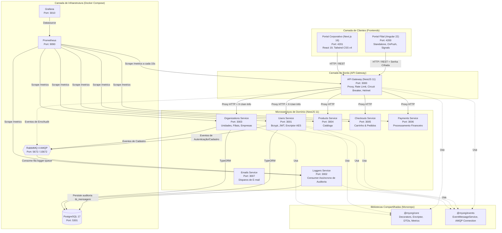
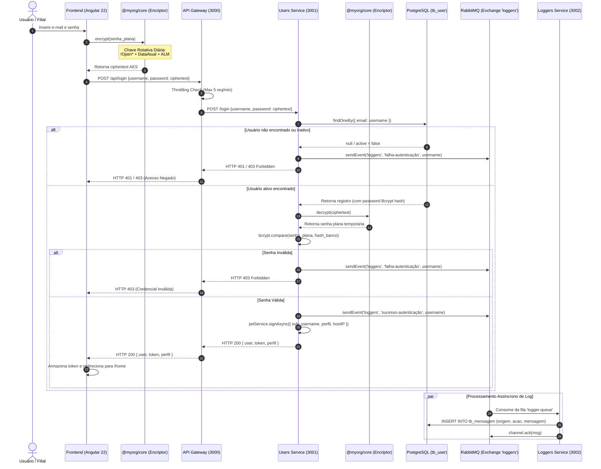
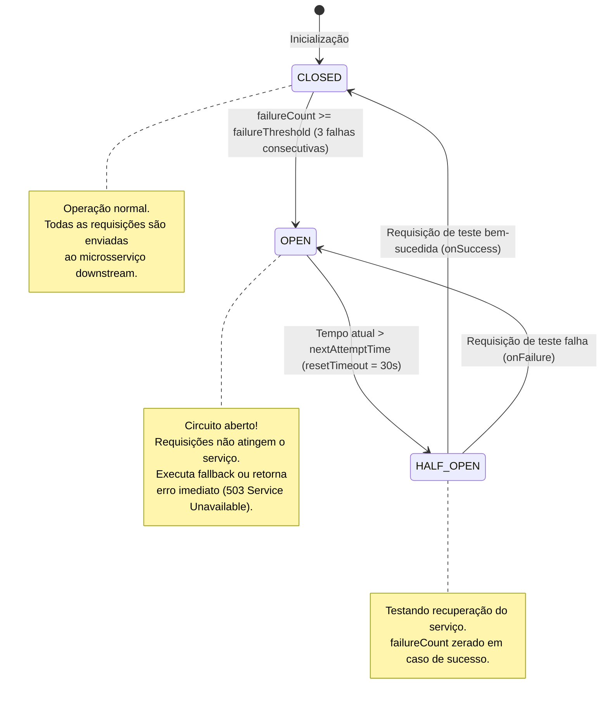
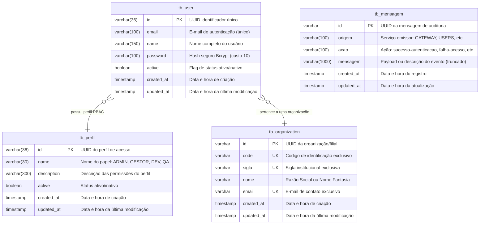
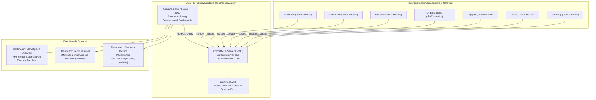

# OpenALM — Documento de Design e Arquitetura do Sistema (Design.md)

| Metadado | Descrição |
| :--- | :--- |
| **Projeto** | OpenALM (Application Lifecycle Management) |
| **Documento** | Especificação Técnica e Arquitetura de Software |
| **Versão** | 1.0.0 |
| **Data** | 2026-11-16 |
| **Status** | Aprovado |

---

## 1. Visão Geral da Arquitetura

O **OpenALM** adota uma **Arquitetura de Microsserviços (Microservices Architecture)** distribuída, combinada com o padrão **Event-Driven Architecture (EDA)** para operações assíncronas e **API Gateway Pattern** como ponto único de entrada e orquestração de borda.

Todo o ecossistema é organizado em um **Monorepo gerenciado por pnpm workspaces** ([`pnpm-workspace.yaml`](file:///home/tales/workspaceIA/openalm/pnpm-workspace.yaml)), garantindo compartilhamento rigoroso de código através de bibliotecas internas (`@myorg/core` e `@myorg/events`) sem acoplamento entre os domínios de negócio.

### 1.1 Mapa de Portas e Topologia da Rede

| Serviço / Componente | Tipo / Framework | Porta Externa | Porta Interna | Descrição Operacional |
| :--- | :--- | :--- | :--- | :--- |
| **API Gateway** ([`apps/gateway`](file:///home/tales/workspaceIA/openalm/apps/gateway/)) | NestJS 11 / Express | `3000` | `3000` | Ponto de entrada único, Auth, Proxy, Circuit Breaker, Swagger |
| **Users Service** ([`apps/users`](file:///home/tales/workspaceIA/openalm/apps/users/)) | NestJS 11 / TypeORM | `3001` | `3001` | Autenticação, usuários, hash Bcrypt, emissão de JWT |
| **Loggers Service** ([`apps/loggers`](file:///home/tales/workspaceIA/openalm/apps/loggers/)) | NestJS 11 / AMQP | `3002` | `3002` | Consumidor RabbitMQ, gravação de auditoria em PostgreSQL |
| **Organizations Service** ([`apps/organizations`](file:///home/tales/workspaceIA/openalm/apps/organizations/)) | NestJS 11 / TypeORM | `3003` | `3003` | Gestão de filiais, organizações, regras de unicidade |
| **Products Service** ([`apps/products`](file:///home/tales/workspaceIA/openalm/apps/products/)) | NestJS 11 | `3004` | `3004` | Catálogo de produtos e serviços associados |
| **Checkouts Service** ([`apps/checkouts`](file:///home/tales/workspaceIA/openalm/apps/checkouts/)) | NestJS 11 | `3005` | `3005` | Orquestração de pedidos e checkout |
| **Payments Service** ([`apps/payments`](file:///home/tales/workspaceIA/openalm/apps/payments/)) | NestJS 11 | `3006` | `3006` | Processamento de transações financeiras e pagamentos |
| **Emails Service** ([`apps/emails`](file:///home/tales/workspaceIA/openalm/apps/emails/)) | NestJS 11 | `3007` | `3007` | Notificações assíncronas por e-mail |
| **Portal Filial** ([`apps/filial`](file:///home/tales/workspaceIA/openalm/apps/filial/)) | Angular 22 Standalone | `4200` | `4200` | Aplicação web para gestão operacional de unidades |
| **Portal Web** ([`apps/web`](file:///home/tales/workspaceIA/openalm/apps/web/)) | Next.js 16 / React 19 | `4201` | `4201` | Portal corporativo moderno estilizado com Tailwind CSS v4 |
| **PostgreSQL 17** ([`docker-compose.yaml`](file:///home/tales/workspaceIA/openalm/docker-compose.yaml#L3-L17)) | Banco Relacional | `5301` | `5432` | Banco de dados corporativo (`openalm_db`) |
| **RabbitMQ 4 AMQP** ([`docker-compose.yaml`](file:///home/tales/workspaceIA/openalm/docker-compose.yaml#L18-L35)) | Mensageria AMQP | `5672` | `5672` | Barramento de eventos assíncronos de alta performance |
| **RabbitMQ Management** | Painel Web | `15672` | `15672` | Interface web de monitoramento de filas e exchanges |
| **Prometheus** ([`docker-compose.yaml`](file:///home/tales/workspaceIA/openalm/docker-compose.yaml#L36-L56)) | Coleta de Métricas | `9090` | `9090` | Engine de telemetria time-series (scrape de 15s) |
| **Grafana** ([`docker-compose.yaml`](file:///home/tales/workspaceIA/openalm/docker-compose.yaml#L57-L77)) | Dashboards / UI | `3010` | `3000` | Painéis visuais provisionados automaticamente |

---

## 2. Diagramas Arquiteturais

### 2.1 Diagrama de Contexto e Topologia Geral do Sistema



---

### 2.2 Diagrama de Sequência: Autenticação Segura e Criptografia Rotativa

O fluxo abaixo detalha a segurança de ponta a ponta: a senha é pré-cifrada no cliente via algoritmo AES com chave dinâmica temporal ([`Encriptor`](file:///home/tales/workspaceIA/openalm/libs/core/src/encrypts/Encriptor.ts)), atravessa o Gateway e é verificada contra o hash Bcrypt no banco de dados, com publicação assíncrona de eventos de auditoria no RabbitMQ.



---

### 2.3 Diagrama da Máquina de Estados: Circuit Breaker

O [`CircuitBreakerService`](file:///home/tales/workspaceIA/openalm/apps/gateway/src/circuit-break/circuit-break.service.ts) protege o Gateway contra indisponibilidade de serviços downstream.



---

### 2.4 Diagrama da Arquitetura Orientada a Eventos (Mensageria AMQP)

O barramento assíncrono baseado em RabbitMQ 4 garante que operações que não exigem resposta síncrona imediata (auditoria, logs de segurança, notificações) sejam desacopladas da thread principal das requisições HTTP.

```mermaid
flowchart LR
    subgraph Producers["Produtores de Eventos (Event Publishers)"]
        G_Prod["API Gateway\nOrigem: GATEWAY"]
        U_Prod["Users Service\nOrigem: USERS"]
        O_Prod["Organizations Service\nOrigem: ORGANIZATIONS"]
        P_Prod["Payments Service\nOrigem: PAYMENTS"]
    end

    subgraph AMQP["RabbitMQ Broker (Port: 5672)"]
        TopicExchange["Topic Exchange: 'loggers'\n(durable: true)"]
        Queue["Queue: 'logger-queue'\n(durable: true, prefetch: 1)"]
        TopicExchange -->|Routing Key: 'logger-message'| Queue
    end

    subgraph Consumer["Consumidor (Logger Consumer)"]
        LogConsumer["LoggerConsumerService\n(apps/loggers/src/logger.consume.ts)"]
        ProcessLogic["Validação & Truncamento\n(mensagem <= 1000 chars)"]
        AuditService["AuditService\n(TypeORM Repository)"]
    end

    subgraph Storage["Armazenamento Permanente"]
        TBMensagem[("Tabela PostgreSQL\ntb_mensagem")]
    end

    G_Prod -->|sendEvent()| TopicExchange
    U_Prod -->|sendEvent()| TopicExchange
    O_Prod -->|sendEvent()| TopicExchange
    P_Prod -->|sendEvent()| TopicExchange

    Queue -->|consume()| LogConsumer
    LogConsumer --> ProcessLogic
    ProcessLogic --> AuditService
    AuditService -->|INSERT| TBMensagem
    AuditService -.->|ack(msg)| Queue
```

---

### 2.5 Diagrama Entidade-Relacionamento (ERD) — Banco de Dados Relacional

O banco de dados centralizado em **PostgreSQL 17** gerencia o isolamento de tabelas através de migrações estruturadas do TypeORM.



---

### 2.6 Pipeline de Observabilidade e Métricas

A coleta de métricas e telemetria é unificada com Prometheus e Grafana:



---

## 3. Especificação Técnica dos Módulos e Componentes

### 3.1 API Gateway ([`apps/gateway`](file:///home/tales/workspaceIA/openalm/apps/gateway/))
- **Entrypoint:** [`main.ts`](file:///home/tales/workspaceIA/openalm/apps/gateway/src/main.ts)
- **Módulo Raiz:** [`AppModule`](file:///home/tales/workspaceIA/openalm/apps/gateway/src/app.module.ts)
- **Segurança e Proteção de Borda:**
  - `helmet`: Política de cabeçalhos estrita com CSP personalizado (`scriptSrc: ['self']`, `frameSrc: ['none']`, HSTS de 1 ano com `includeSubDomains` e `preload`).
  - `cors`: Liberação granular baseada na variável de ambiente `CORS_ALLOWED_ORIGINS` com suporte a credenciais e cache prévio (`maxAge: 86400`).
  - [`CustomThrottlerGuard`](file:///home/tales/workspaceIA/openalm/apps/gateway/src/guards/throttler.guard.ts): Aplicação global de rate-limiting em 3 camadas (10/s, 100/min, 1000/15min).
  - [`LoggingMiddleware`](file:///home/tales/workspaceIA/openalm/apps/gateway/src/middleware/logging.middleware.ts): Interceptação de 100% das requisições para cálculo de latência e log de método/status.
- **Circuit Breaker Service ([`CircuitBreakerService`](file:///home/tales/workspaceIA/openalm/apps/gateway/src/circuit-break/circuit-break.service.ts)):**
  - Mantém tabela de circuitos em memória por chave de serviço.
  - Parâmetros padrão: `failureThreshold: 3`, `timeout: 30000ms`, `resetTimeout: 30000ms`.
  - Estados implementados: `CLOSED`, `OPEN`, `HALF_OPEN`.
- **Proxy Service ([`ProxyService`](file:///home/tales/workspaceIA/openalm/apps/gateway/src/proxy/proxy.service.ts)):**
  - Encaminha chamadas HTTP via `HttpService` com timeout configurado.
  - Injeta o cabeçalho `X-User-Info` com dados de sessão validados.
  - Executa a requisição encapsulada dentro do Circuit Breaker.
- **Documentação Swagger:** Rota `/api` configurada com `DocumentBuilder` cobrindo autenticação, usuários, organizações, produtos e checkout.

### 3.2 Microsserviço de Usuários ([`apps/users`](file:///home/tales/workspaceIA/openalm/apps/users/))
- **Controlador e Serviços:** [`AppController`](file:///home/tales/workspaceIA/openalm/apps/users/src/app.controller.ts) e [`AppService`](file:///home/tales/workspaceIA/openalm/apps/users/src/app.service.ts)
- **Fluxo Criptográfico:**
  1. Recebe a senha cifrada com algoritmo AES rotativo gerado no frontend.
  2. Descriptografa via [`Encriptor.decrypt()`](file:///home/tales/workspaceIA/openalm/libs/core/src/encrypts/Encriptor.ts#L11-L13).
  3. Compara o texto plano resultante contra o hash Bcrypt armazenado na entidade [`User`](file:///home/tales/workspaceIA/openalm/apps/users/src/entities/user.entity.ts) via `bcrypt.compare`.
  4. Na criação de usuário, realiza o hash via `bcrypt.hash(password, 10)`.
- **Geração e Verificação de JWT:**
  - Token gerado com chave `JWT_SECRET`, contendo identificador, e-mail, nome, perfil e o `hostIP` da requisição.
  - Método `checkToken()` verifica integridade do token e conformidade com o IP de rede da sessão.
- **Integração com Mensageria:**
  - Publica eventos via [`EventMessageService`](file:///home/tales/workspaceIA/openalm/libs/events/src/event.service.ts) para `sucesso-autenticação`, `falha-autenticação`, `sucesso-cadastro-usuario` e `error-cadastro-usuario`.

### 3.3 Microsserviço de Organizações ([`apps/organizations`](file:///home/tales/workspaceIA/openalm/apps/organizations/))
- **Controlador e Serviços:** [`AppController`](file:///home/tales/workspaceIA/openalm/apps/organizations/src/app.controller.ts) e [`AppService`](file:///home/tales/workspaceIA/openalm/apps/organizations/src/app.service.ts)
- **Regras de Negócio e Persistência:**
  - Persiste organizações na tabela `tb_organization` ([`Organization`](file:///home/tales/workspaceIA/openalm/apps/organizations/src/entities/organization.entity.ts)).
  - Garante unicidade através de índices criados na migração: [`uk_organizationCode`](file:///home/tales/workspaceIA/openalm/apps/organizations/migrations/1781465754599-createTableOrganization.ts#L17), `uk_organizationSigla` e `uk_organizationEmail`.
  - Dispara eventos assíncronos de cadastro para a exchange `loggers`.

### 3.4 Microsserviço de Auditoria / Loggers ([`apps/loggers`](file:///home/tales/workspaceIA/openalm/apps/loggers/))
- **Consumidor:** [`LoggerConsumerService`](file:///home/tales/workspaceIA/openalm/apps/loggers/src/logger.consume.ts)
- **Serviço de Fila:** [`LoggerQueueService`](file:///home/tales/workspaceIA/openalm/apps/loggers/src/logger.service.ts)
- **Processamento Confiável:**
  - Configura consumidor na fila `logger-queue` vinculada à exchange `loggers` com routing key `logger-message`.
  - Configura `prefetch(1)` para evitar sobrecarga de memória no nó consumidor.
  - Trunca payloads maiores que 1.000 caracteres para evitar violações de schema.
  - Persiste na tabela `tb_mensagem` ([`Audit`](file:///home/tales/workspaceIA/openalm/apps/loggers/src/entities/audit.entity.ts)).
  - Executa `channel.ack(msg)` após gravação com sucesso ou `channel.nack(msg, false, false)` em falhas irrecuperáveis.

### 3.5 Bibliotecas Compartilhadas (Shared Libs)

#### `@myorg/core` ([`libs/core`](file:///home/tales/workspaceIA/openalm/libs/core/))
- **Criptografia Rotativa:** [`Encriptor`](file:///home/tales/workspaceIA/openalm/libs/core/src/encrypts/Encriptor.ts) — Implementa AES com parâmetro de rotação temporal dinâmico (`!Open*` + data local + `ALM#`).
- **Decorators de Autorização:**
  - [`@CurrentUser()`](file:///home/tales/workspaceIA/openalm/libs/core/src/decorators/current-user.decorator.ts): Extrai usuário autenticado do request.
  - [`@Public()`](file:///home/tales/workspaceIA/openalm/libs/core/src/decorators/public.decorator.ts): Desvia guards de autenticação em rotas públicas.
  - [`@Roles(...)`](file:///home/tales/workspaceIA/openalm/libs/core/src/decorators/roles.decorator.ts): Vincula perfis necessários para acesso.
- **Interfaces e Contratos Compartilhados:** [`Organization`](file:///home/tales/workspaceIA/openalm/libs/core/src/interfaces/organization.ts), [`OrganizationCreateRequest`](file:///home/tales/workspaceIA/openalm/libs/core/src/interfaces/organizationCreateRequest.ts), [`UserLoginRequest`](file:///home/tales/workspaceIA/openalm/libs/core/src/interfaces/userLoginRequest.ts), [`UserCreateRequest`](file:///home/tales/workspaceIA/openalm/libs/core/src/interfaces/userCreateRequest.ts), [`ConsumerMetrics`](file:///home/tales/workspaceIA/openalm/libs/core/src/interfaces/consumerMetrics.ts).

#### `@myorg/events` ([`libs/events`](file:///home/tales/workspaceIA/openalm/libs/events/))
- **Gerenciador de Mensageria:** [`EventMessageService`](file:///home/tales/workspaceIA/openalm/libs/events/src/event.service.ts)
  - Gerenciamento de ciclo de vida com `OnModuleInit` e `OnModuleDestroy`.
  - Tratamento de reconexão e eventos de canal (`error`, `close`, `blocked`, `unblocked`).
  - Publicação atômica em exchanges do tipo `topic` com mensagens persistentes.
  - Assinatura tipada de filas com confirmação explícita de entrega (`channel.ack` / `channel.nack`).

### 3.6 Frontend Angular 22 Filial ([`apps/filial`](file:///home/tales/workspaceIA/openalm/apps/filial/))
- **Paradigma:** Componentes 100% Standalone (sem NgModules legados), detecção `OnPush` padrão e injeção de dependências moderna com `inject()`.
- **Roteamento Modular:** [`app.routes.ts`](file:///home/tales/workspaceIA/openalm/apps/filial/src/app.routes.ts) com suporte a Splash Screen, Abertura com abas institucionais (`/access/*`), Login com criptografia de ponta e painel administrativo (`/home/*`).
- **Segurança no Cliente:** [`LoginService`](file:///home/tales/workspaceIA/openalm/apps/filial/src/services/LoginService.ts) realiza a cifragem imediata da senha com `@myorg/core/Encriptor` antes do envio HTTP.
- **Interceptor de Erros:** [`http-error.interceptor.ts`](file:///home/tales/workspaceIA/openalm/apps/filial/src/interceptors/http-error.interceptor.ts) captura falhas 401/403/500 e aciona diálogos amigáveis para o operador.

### 3.7 Frontend Next.js 16 Web ([`apps/web`](file:///home/tales/workspaceIA/openalm/apps/web/))
- **Tecnologias:** Next.js 16 (App Router), React 19, Tailwind CSS v4, suporte a renderização híbrida (Server Components e Client Components).

---

## 4. Contratos de API e Protocolos de Comunicação

### 4.1 Principais Endpoints do API Gateway (Porta 3000)

| Método | Endpoint | Descrição | Autenticação | Rate Limit |
| :--- | :--- | :--- | :--- | :--- |
| `POST` | `/api/login` | Autentica usuário e retorna JWT | Pública | 5 req / minuto |
| `POST` | `/api/register` | Cadastra novo usuário na base | Pública | 3 req / minuto |
| `GET` | `/api/organizations` | Lista organizações e filiais | Bearer JWT | 5 req / minuto |
| `POST` | `/api/organizations/create` | Cria nova organização | Bearer JWT | 3 req / minuto |
| `GET` | `/health` | Healthcheck do API Gateway | Pública | Sem limite |
| `GET` | `/metrics` | Métricas operacionais Prometheus | Pública/Interna | Sem limite |
| `GET` | `/api` | Documentação interativa Swagger | Pública | Sem limite |

### 4.2 Formato do Cabeçalho Enriquecido de Proxy (`X-User-Info`)
Ao realizar o repasse de requisições autenticadas para os microsserviços downstream, o [`ProxyService`](file:///home/tales/workspaceIA/openalm/apps/gateway/src/proxy/proxy.service.ts#L41) injeta o seguinte cabeçalho serializado em JSON:

```json
{
  "userId": "a1b2c3d4-e5f6-7890-abcd-ef1234567890",
  "email": "gestor@openalm.com",
  "role": "ADMIN"
}
```

---

## 5. Estratégia de Deploy, Infraestrutura e Execução Local

### 5.1 Pré-requisitos
- **Node.js:** `v24.17.0` (suporte a ESM nativo e performance V8)
- **Gerenciador de Pacotes:** `pnpm v11.8.0`
- **Docker & Docker Compose:** Versão 24+ com suporte a compose v2

### 5.2 Inicialização da Infraestrutura Compartilhada
Para subir PostgreSQL 17, RabbitMQ 4, Prometheus e Grafana:

```bash
# Executa contêineres em segundo plano
docker compose up -d

# Verifica o status de saúde dos serviços
docker compose ps
```

### 5.3 Execução das Aplicações no Monorepo
Com o monorepo pnpm configurado, os serviços podem ser executados através dos scripts raiz de [`package.json`](file:///home/tales/workspaceIA/openalm/package.json#L7-L20):

```bash
# Instalação completa das dependências
pnpm install

# Build prévio obrigatório das libs compartilhadas
pnpm --filter "./libs/**" run build

# Inicialização de todos os serviços simultaneamente
pnpm start

# Inicialização apenas do núcleo essencial (Gateway + Users + Loggers)
pnpm start:dev

# Parada segura de todos os nós em execução
pnpm run stop
```

---

## 6. Matriz de Rastreabilidade: Requisitos x Arquitetura

| Requisito PRD | Componente Responsável no Design | Arquivo / Código Fonte |
| :--- | :--- | :--- |
| **RF-001 (Gateway Roteamento)** | API Gateway Module | [apps/gateway/src/app.module.ts](file:///home/tales/workspaceIA/openalm/apps/gateway/src/app.module.ts) |
| **RF-003 (Rate Limiting)** | Throttler Guard | [apps/gateway/src/guards/throttler.guard.ts](file:///home/tales/workspaceIA/openalm/apps/gateway/src/guards/throttler.guard.ts) |
| **RF-004 (Circuit Breaker)** | Circuit Breaker Service | [apps/gateway/src/circuit-break/circuit-break.service.ts](file:///home/tales/workspaceIA/openalm/apps/gateway/src/circuit-break/circuit-break.service.ts) |
| **RF-006 (Cadastro Usuários)** | Users Controller & TypeORM | [apps/users/src/app.service.ts](file:///home/tales/workspaceIA/openalm/apps/users/src/app.service.ts#L99-L120) |
| **RF-008 (Criptografia AES)** | Encriptor Compartilhado | [libs/core/src/encrypts/Encriptor.ts](file:///home/tales/workspaceIA/openalm/libs/core/src/encrypts/Encriptor.ts) |
| **RF-009 (Token JWT Seguro)** | JWT Service & Auth Guard | [apps/users/src/app.service.ts](file:///home/tales/workspaceIA/openalm/apps/users/src/app.service.ts#L77-L82) |
| **RF-012 (Organizações)** | Organizations Service | [apps/organizations/src/app.service.ts](file:///home/tales/workspaceIA/openalm/apps/organizations/src/app.service.ts) |
| **RF-015 (Mensageria AMQP)** | Event Message Service | [libs/events/src/event.service.ts](file:///home/tales/workspaceIA/openalm/libs/events/src/event.service.ts) |
| **RF-016 (Auditoria e Logs)** | Logger Consumer Service | [apps/loggers/src/logger.consume.ts](file:///home/tales/workspaceIA/openalm/apps/loggers/src/logger.consume.ts) |
| **RF-022 (Frontend Filial)** | Angular 22 Standalone Routes | [apps/filial/src/app.routes.ts](file:///home/tales/workspaceIA/openalm/apps/filial/src/app.routes.ts) |
| **RNF-OBS-001 (Métricas)** | Prometheus & Metrics Service | [apps/observability/prometheus/prometheus.yml](file:///home/tales/workspaceIA/openalm/apps/observability/prometheus/prometheus.yml) |
